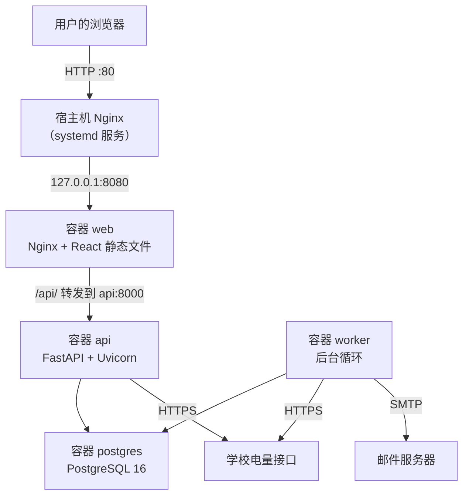

# 零基础指南 · 2026-09 更新版（代码导览）

> 桌面 PDF《Electricity Monitor：从零搭建与全栈技术学习手册（2026-08-29）》的**配套更新**。
>
> PDF 回答"每个技术是什么、为什么需要它"；这份文档回答两件 PDF 没讲透的事：
> **① 这些技术在代码里到底是哪几行、按什么顺序读；② 部署方式已经从 systemd 换成 Docker，PDF 的部署章节已过时。**

---

## 0. 怎么用这份文档

| 文档 | 作用 | 什么时候看 |
|---|---|---|
| 桌面 PDF（2026-08-29） | 技术原理、概念解释、算法推导 | 学概念时查 |
| **本文档** | 代码地图 + 部署更新 + 阅读顺序 | 想"这功能在哪"时查 |
| `SRE_LEARNING_PATH.md` | 8 周计划、面试考点 | 每周开始前 |
| `DOCKER_BEGINNER_GUIDE.md` | Docker 零基础名词解释 | 卡在 Docker 概念时 |

### PDF 阅读地图：哪些还准，哪些已过时

| PDF 部分 | 状态 | 怎么处理 |
|---|---|---|
| 第 1、3、4、5、6 章（全局认识、项目演化、架构、一次检查的数据流、目录地图） | ✅ 完全有效 | **先读这 5 章**，建立整体印象 |
| 第 7–9 章（Git、HTTP、Python 虚拟环境） | ✅ 完全有效 | 补基础用 |
| 第 10–13 章（Node/Vite/TypeScript、FastAPI、Pydantic、配置系统） | ✅ 完全有效 | 第 11–13 章是理解后端的钥匙 |
| 第 14–19 章（数据库、SQLAlchemy、Alembic、认证、限流、加密存储） | ✅ 完全有效 | 第 14–15 章必读 |
| 第 20–26 章（宿舍模型、学校接口客户端、Token 池、读数表、日均算法、阈值、SMTP） | ✅ 完全有效 | 第 23–25 章是业务核心 |
| 第 31–44 章（前端、本机启动 API/数据库/Worker） | ⚠️ 本地开发仍可用 | 服务器上已改成 Docker，见本文第 3 章 |
| 最后约 10 章（部署、systemd、宿主机 Nginx 直读 `frontend/dist`、长期维护） | ❌ **已过时** | 现在全部容器化，见本文第 3 章 |
| 附录 | ✅ | 查表用 |

**一句话**：PDF 的技术原理都还对，**只有"怎么把东西跑在服务器上"这一块被 Docker 取代了**。

---

## 1. 你的系统现在长什么样（2026-09 实况）

### 1.1 架构



### 1.2 示例端口与网络（按部署环境核对）

| 监听地址 | 端口 | 是谁 | 含义 |
|---|---|---|---|
| `0.0.0.0:80` | 80 | 宿主机 nginx | **唯一对公网开放的入口** |
| `0.0.0.0:22` | 22 | sshd | SSH 登录 |
| `127.0.0.1:8080` | 8080 | docker-proxy | web 容器，**只允许本机访问** |
| `192.0.2.10:56789` | 56789 | docker-proxy | Portainer |
| `0.0.0.0:27776` | 27776 | 1panel-core | 1Panel 面板 |
| `127.0.0.1:5432/5433/5434` | — | 宿主机自装 postgres | ⚠️ **不是**容器里的数据库 |

Docker 内部网络 `sdu-qingdao-electricity-monitor_appnet`（`172.30.0.0/24`）：

```text
postgres -> 172.30.0.2
web      -> 172.30.0.3
api      -> 172.30.0.4
worker   -> 172.30.0.5
```

容器之间**用服务名互相找**（`api:8000`、`postgres:5432`），因为容器重建后 IP 会变，而 Docker 内置 DNS 永远把服务名解析到当前 IP。

### 1.3 五个服务的职责（`compose.prod.yml`）

| 服务 | 启动命令 | 职责 | 重启策略 |
|---|---|---|---|
| `postgres` | 官方镜像 | 存所有数据，**不对宿主机开放端口** | `unless-stopped` |
| `migrate` | `python -m app.scripts.init_db` | 只跑一次：建表/迁移/确认管理员 | `"no"`（故意不自动重启） |
| `api` | `uvicorn app.main:app` | 处理浏览器请求 | `unless-stopped` |
| `worker` | `python -m app.worker` | 定时查电量、发提醒、清数据 | `unless-stopped` |
| `web` | Nginx + React 构建产物 | 发静态文件 + 转发 `/api` | `unless-stopped` |

**启动顺序由健康检查决定**，不是"睡几秒"：

```text
postgres 健康(pg_isready) → migrate 跑完 → api 健康(/health) → web 启动
```

> 这是面试可讲的点：`depends_on` 只保证"启动顺序"，`condition: service_healthy` 才保证"真的能用了"。

### 1.4 备份与回滚（这是你项目最像"生产"的部分）

每次发布前，先做三份备份，存到 `/opt/sdu-qingdao-electricity-monitor/backups/frontend-<时间戳>/`：

| 文件 | 内容 |
|---|---|
| `web-image.tar.gz` | 当前线上镜像完整导出 |
| `static-html.tar.gz` | 容器内 `/usr/share/nginx/html` 原始文件 |
| `frontend-source.tar.gz` | 服务器上的前端源码 |
| `SHA256SUMS` | 三份文件的校验和 |

回滚 = 用备份镜像的 tag 重新起容器（不需要重新构建）。**"能不能回滚"比"能不能发布"更重要**——这是 SRE 面试高频考点。

---

## 2. 代码导览（解决"看不懂 AI 写的代码"）

### 2.1 读代码的正确顺序

**不要**从 `AdminApp.tsx`（管理后台，几千行）或 `me.py`（28KB）开始。按这个顺序读，每一步都只依赖上一步：

| 步 | 文件 | 你要看懂什么 |
|---|---|---|
| 1 | `backend/app/main.py` | 应用怎么创建、装了哪几个中间件、路由怎么挂载 |
| 2 | `backend/app/api/router.py` | 一共有哪几组 API |
| 3 | `backend/app/api/routes/health.py` | 最短的路由长什么样（8 行） |
| 4 | `backend/app/api/routes/announcements.py` | 一个带数据库查询和鉴权的完整路由 |
| 5 | `backend/app/api/deps.py` | 身份是怎么验的（`current_user`） |
| 6 | `backend/app/db/session.py` | 数据库连接和 Session 从哪来 |
| 7 | `backend/app/models/announcement.py` | 一张表在 Python 里长什么样 |
| 8 | `backend/app/schemas/announcement.py` | 返回给浏览器的结构（和 model 不一样！） |
| 9 | `backend/app/worker.py` | 后台进程在循环做什么 |
| 10 | `frontend/src/main.tsx` → `App.tsx` → `lib/api.ts` | 前端怎么调后端 |

### 2.2 一次请求的完整生命周期（真实端点：`GET /api/announcements`）

这是你登录页上那条公告的真实获取过程，一共 10 跳：

| # | 发生什么 | 代码位置 |
|---|---|---|
| 1 | 浏览器 `fetch("/api/announcements")` | `frontend/src/lib/api.ts` 的 `listAnnouncements()` |
| 2 | 宿主机 Nginx 收到 `:80` 请求，转给 `127.0.0.1:8080` | `/etc/nginx/sites-enabled/...` |
| 3 | 容器 `web` 的 Nginx 看到路径以 `/api/` 开头，转给 `http://api:8000` | `deploy/nginx.conf` |
| 4 | Uvicorn 收到请求，调用 ASGI 应用 | `compose.prod.yml` 里 api 的 `command` |
| 5 | 应用对象由 `create_app()` 创建，依次经过 4 个中间件 | `backend/app/main.py` |
| 6 | 路由匹配：总路由 → 公告路由（`prefix="/api/announcements"`） | `backend/app/api/router.py` |
| 7 | 执行处理函数 `list_published_announcements()` | `backend/app/api/routes/announcements.py:18` |
| 8 | FastAPI 先解析两个依赖：`optional_user`（可选登录）和 `db_session`（数据库会话） | `backend/app/api/deps.py` |
| 9 | SQLAlchemy 生成 SQL 并执行（只查已发布、按发布时间倒序、最多 10 条） | `announcements.py:27-40` |
| 10 | 结果按 `response_model=list[AnnouncementOut]` 序列化成 JSON 返回 | `backend/app/schemas/announcement.py` |

**逐跳验证命令**（你自己敲一遍，看每一跳）：

```bash
ssh username@192.0.2.10
docker exec sdu-qingdao-electricity-monitor-web-1 wget -qO- --header='Host: 192.0.2.10' http://api:8000/api/announcements | head -c 200
docker logs --tail 5 sdu-qingdao-electricity-monitor-api-1
curl -s http://127.0.0.1/api/announcements | head -c 200
```

> 注意 `--header='Host: ...'`：api 装了 `TrustedHostMiddleware`（`main.py`），Host 不在白名单会返回 **400**，不是网络问题。白名单来源见 `backend/app/core/http_security.py:14`（`TRUSTED_HOSTS` + 固定的 `127.0.0.1/localhost/::1`）。

### 2.2.1 顺带看懂 `deploy/nginx.conf`（只有 60 行，全是要点）

| 配置 | 作用 | 面试价值 |
|---|---|---|
| `location /api/ { proxy_pass http://api:8000; }` | 把 API 请求转给容器 `api` | 反向代理的核心一行 |
| `proxy_set_header Host $host;` | 保留原始 Host | 不加的话 api 的 TrustedHost 会拒绝 |
| `proxy_set_header X-Real-IP $remote_addr;` | 记录真实客户端 IP | 否则日志里全是代理地址 |
| `proxy_set_header X-Forwarded-For $http_x_real_ip;` | **用上一层给的值覆盖，而不是追加** | 防止客户端伪造 IP（PDF 18.4 节） |
| `location / { try_files $uri $uri/ /index.html; }` | 前端单页应用路由回退 | 刷新 `/records` 不 404 的原因 |
| `location ~ /\.(?!well-known) { deny all; }` | 禁止访问 `.env`、`.git` 等隐藏文件 | 上线前必查项 |
| `location ~* \.(bak\|conf\|db\|sql\|zip)$ { deny all; }` | 禁止下载备份/配置文件 | 防止源码与数据泄露 |
| `add_header Content-Security-Policy ...` | 限制页面能加载什么 | XSS 纵深防御 |

**这 8 条就是"生产环境 Nginx"和"能跑的 Nginx"的区别**，你可以直接用这张表回答"Nginx 你都配了什么"。

### 2.3 目录职责表

| 目录 | 职责 | 记住这一句 |
|---|---|---|
| `backend/app/api/routes/` | HTTP 接口层 | **只做"接收请求、校验、调 service、返回"** |
| `backend/app/api/deps.py` | 鉴权与依赖注入 | 谁在请求？验 token、查用户 |
| `backend/app/services/` | 业务逻辑 | 真正的"干活"代码，可被 API 和 Worker 共用 |
| `backend/app/models/` | SQLAlchemy 表模型 | 数据库里有什么表 |
| `backend/app/schemas/` | Pydantic 输入输出结构 | 接口能收什么、返回什么 |
| `backend/app/core/` | 配置、安全、加密、HTTP 安全 | `config.py` 读 `.env`；`security.py` 密码与令牌 |
| `backend/app/db/` | Engine、Session、建表兼容 | `session.py` 里 `get_db()` |
| `backend/app/electricity/` | 学校接口客户端 | `hwgl_client.py` / `client.py` 发外部请求 |
| `backend/app/scripts/` | 一次性脚本 | `init_db.py`、`create_admin.py`、`encrypt_credentials.py` |
| `backend/app/worker.py` | 后台进程入口 | 循环 + 时间槽调度 |
| `frontend/src/components/` | 页面与组件 | `AppShell` 是外壳，`DashboardView` 是首页 |
| `frontend/src/lib/` | API 客户端、类型、外观工具 | `api.ts` 是所有请求的出口 |

### 2.3.1 `app/services/` 明细（真正的业务逻辑都在这）

| 文件 | 干什么 | 关键函数（带行号） |
|---|---|---|
| `usage.py` | 读数查询 + 日均/剩余天数/低电量计算 | `list_room_readings:69`、`calculate_average_daily_usage:266`、`build_usage_stats:281`、`get_room_usage_stats:375` |
| `electricity_queries.py` | 查询编排：取 token → 调上游 → 记健康 → 出结果 | `execute_room_query:19`、`apply_query_resolution:45` |
| `room_checks.py` | 单房间查询落库 + 批量定时检查 | `check_and_store_room:42`、`list_due_rooms:120`、`run_room_checks:152` |
| `token_pool.py` | mcard token 池：挑一个可用的并**先占坑再发请求** | `select_available_token:31`、`reserve_available_token:62` |
| `token_health.py` | 记录每个 token 的成功/失败与健康状态 | `record_token_health:13` |
| `notifications.py` | 低电量提醒、每日报告、测试邮件 | `run_low_power_notifications:393`、`run_daily_reports:358` |
| `emailer.py` | 多 SMTP 账号轮询发送 + 投递日志 | `load_smtp_configs:87`、`send_email:293` |
| `hwgl_sync.py` | HWGL 每日读数/充值/单价同步 | `run_hwgl_metadata_sync:258` |
| `data_retention.py` | 按保留策略清理过期数据 | `run_data_retention_cleanup:142` |
| `runtime_settings.py` | 管理员可改的运行时参数（存 `app_settings` 表） | `get_runtime_config:49` |
| `scheduled_jobs.py` | 定时任务"时间槽"去重与重试纪律 | `claim_scheduled_job:82`、`run_scheduled_job:150` |
| `rate_limit.py` | 内存限流 + 真实客户端 IP 解析 | `enforce_rate_limit:143` |
| `appearance.py` / `appearance_assets.py` | 外观设置读写、上传图压缩与预模糊 | `update_appearance_settings:31`、`build_preblurred_background:16` |

### 2.3.2 读代码时请直接跳过：**跑不到的代码**

这是你"越读越乱"的一个真实原因——项目里存在**写了但没被调用**的代码。这些不是你要学的部分：

| 位置 | 状态 | 怎么确认的 |
|---|---|---|
| `backend/app/api/routes/rooms.py` | **未挂载**，访问不到 | `api/router.py` 的 7 行 `include_router` 里没有它 |
| `backend/app/services/scheduler.py` | `start_background_tasks` **无调用点** | `main.py` 里没有任何 lifespan/startup 钩子 |
| `backend/app/worker.py` 的 `next_aligned_time` / `next_daily_time` | 未被 `main()` 使用 | 主循环用的是 `_run_slot` + `completed_slots` |
| `backend/app/db/schema.py` | **历史兼容包袱**，新结构不用看它 | 它只服务于"早期用 `create_all` 建库、没有迁移历史"的旧安装 |

> 面试小技巧：如果被问"你怎么看遗留代码"，你可以答——**先确认真实调用链（`router.py` 有没有 include），再决定是删还是留；未挂载的路由是死代码，应该删掉或补挂载，否则是安全风险**（比如 `rooms.py` 那种旧公开接口，万一哪天被误挂上去就是漏洞）。

### 2.4 数据表地图

| 表 | 职责 |
|---|---|
| `users` | 用户账号、提醒邮箱、日报设置 |
| `admin_users` | 管理员（和普通用户完全分开） |
| `rooms` | 唯一宿舍位置（`campus_param + building_param + room_number` 唯一） |
| `user_rooms` | 用户↔宿舍绑定 + 提醒参数（多对多的中间表） |
| `electricity_readings` | **成功**的余额读数（时间序列，画曲线用） |
| `check_attempts` | **每一次**查询尝试，成功失败都记 |
| `auth_tokens` | 学校接口 Token 池 |
| `auth_token_health_logs` | Token 健康状态变化历史 |
| `smtp_settings` / `smtp_health_logs` | 邮件账号池与健康记录 |
| `email_delivery_logs` | 所有邮件投递结果 |
| `notifications` | 低电量提醒记录（用于去重冷却） |
| `email_verification_codes` | 注册验证码 + 待注册密码哈希 |
| `scheduled_job_runs` | Worker 时间槽、去重、失败重试 |
| `app_settings` | 管理员可改的运行时配置与外观配置 |
| `admin_audit_logs` | 管理员敏感操作审计 |

> **易错点**：`electricity_readings` 和 `check_attempts` 是两张表。连续三次查询（成功、超时、认证失败）→ 读数表只有 1 条，尝试表有 3 条。这样曲线不会因为失败而掉到 0，但管理后台仍能排错。

### 2.5 鉴权的三个函数（`backend/app/api/deps.py`）

```python
current_user    # 必须登录：解析 Bearer token → 查 User → 校验凭据戳，否则 401
verified_user   # 必须登录 + 邮箱已验证，否则 403
current_admin   # 必须管理员：token 里 kind 必须是 "admin"
optional_user   # 登录了就返回用户，没登录返回 None（公告接口用它）
```

**"凭据戳"是什么**：token 里带了一个由当前 `password_hash` 生成的字段，改密码后哈希变了 → 旧 token 全部失效。这是"撤回所有登录"的实现方式（PDF 第 17.5 节）。

### 2.6 Worker 主循环（`backend/app/worker.py`）

```text
启动 → 注册信号处理（收到 SIGTERM 时把 stopping 置为 True，优雅退出）
     → 循环：
         读取运行时配置（从数据库 app_settings，不是 .env）
         判断每个任务的"时间槽"是否到点（latest_aligned_slot / next_daily_time）
         到点就调用对应 service，并把结果写进 scheduled_job_runs 去重
         sleep 一小段时间，重复
```

它每一轮（默认 10 秒一轮）按**固定顺序**尝试这些任务：

| # | 任务 | 触发节奏 | 代码位置 |
|---|---|---|---|
| 1 | `room_checks` 批量查电量 | 每 4 小时（对齐时间槽） | `worker.py:110-118` |
| 2 | 检查完补一轮提醒 | 跟 #1 同槽位 | `worker.py:119-128` |
| 3 | 低电量提醒 | 每 1 小时 | `worker.py:129-137` |
| 4 | 每日报告 | 每天 8:00 | `worker.py:139-145` |
| 5 | HWGL 元数据同步 | 每 24 小时 | `worker.py:146-155` |
| 6 | 数据清理 | 每天 3:00 | `worker.py:156-162` |
| 7 | HWGL 探针采样 | 每轮都试 | `worker.py:163-165` |

两个关键设计：

- **单个任务失败不会杀死 Worker**：整个循环包在 `try/except Exception` 里（`worker.py:166-167`），只记日志，下一轮继续。
- **去重靠数据库**：`scheduled_job_runs` 表对 `(job_name, scheduled_for)` 建了唯一约束（`models/scheduled_job_run.py:12`）。即使同时跑两个 Worker，也只有一个能抢到槽位。这就是"分布式定时任务不重复执行"的最小实现。

**为什么 Worker 要独立于 API**：API 重启不会带走定时任务；`main.py` 里**没有任何后台任务启动代码**，定时任务必须靠独立的 `python -m app.worker` 进程。

### 2.6.1 两个数据源，和一个 Token 池

你项目有两个完全不同的上游数据源，**这是理解业务的关键分叉**：

| provider | 是什么 | 需要 Token 吗 | 客户端 |
|---|---|---|---|
| `mcard` | 校园卡平台 | **需要**，从 Token 池取 | `electricity/client.py` |
| `hwgl` | 宿舍水电网 | **不需要**（自建账号） | `electricity/hwgl_client.py` |

分流发生在 `electricity/provider.py` 的 `query_electricity()`（`:27`）：看房间的 `provider` 字段决定调哪个客户端。

**Token 池为什么存在**（`services/token_pool.py`）：
- mcard 的每次查询都必须带一个"登录态 token"，而每个 token 有**最小调用间隔**（`auth_tokens.min_interval_seconds`）
- 所以需要：池化 + 限速 + 并发安全
- 挑选顺序：**从未使用的优先**，其余按"下一次可用时间"排序；用 `with_for_update(skip_locked=True)` 抢锁，被别的进程锁住的直接跳过
- **先占坑再发请求**（`reserve_available_token:62`，短事务）——如果等请求完再记录，两个并发请求会选中同一个 token
- token 值在数据库里是**加密存储**的（`core/secret_storage.py` 的 `EncryptedText`）

> 这三点（池化、限速、原子占用）就是面试里"你怎么设计一个限流/资源池"的标准答案，你项目里有真实实现。

### 2.7 前端数据流

```text
main.tsx
  ├─ applyStoredAppearanceSettings()   ← 先把外观（背景/玻璃）刷上，避免闪烁
  └─ QueryClientProvider               ← TanStack Query：缓存"服务器状态"
       └─ App.tsx
            ├─ 无 token → AuthPanel（登录/注册）
            └─ 有 token → AppShell（侧边栏 + 顶栏 + 内容区）
                 └─ 按 activeView 渲染 DashboardView / RoomsView / RecordsView / SettingsView
```

- **token 存在哪**：`localStorage` 的 `sdu-electricity-token`
- **怎么带上**：`lib/api.ts` 的 `request()` 统一加 `Authorization: Bearer ...`
- **怎么拿到数据**：`useQuery({ queryKey, queryFn })`；改完数据用 `invalidateQueries` 让缓存失效并自动重拉
- **API 地址**：`import.meta.env.VITE_API_BASE_URL ?? window.location.origin` —— 生产环境走同源，所以**不设置** `VITE_API_BASE_URL`
- **视图组件自己不发请求**：所有 `useQuery` / `useMutation` 都集中在 `App.tsx`，视图组件（`DashboardView` 等）只接收 props。**所以你在 `DashboardView.tsx` 里搜 `fetch` 是搜不到的**——这是你之前"看不懂"的一个典型原因。
- **管理端是另一套**：访问路径以 `/admin` 开头才会加载 `AdminApp`（懒加载），用**独立的 admin token**（`localStorage` 的 `sdu-electricity-admin-token`）。
- **外观设置怎么生效**：`lib/appearance.ts` 的 `applyAppearanceSettings`（`:104`）往 `<html>` 上写 CSS 变量（`--app-bg-image`、`--glass-*`）和 `data-glass-mode` 属性，再由 `styles.css` 消费——所以改外观不需要重新构建前端。
- **深色模式**：给 `<html>` 加/去一个 `dark` class（`App.tsx:113`），CSS 里 `.dark` 前缀的规则随之生效。

### 2.7.1 前端学到哪为止（SRE 视角）

目标岗位是 SRE / 运维开发，**不需要会写 React**。但下面三件事必须会，否则排障时会卡住：

| 必须会 | 为什么 | 怎么练 |
|---|---|---|
| 看浏览器 DevTools 的 **Network 面板** | 用户说"页面打不开"时，第一手证据在这里（状态码、请求头、响应体、耗时） | 打开自己站点 → F12 → Network → 逐个请求看 Headers |
| 懂**前后端契约** | 面试必问"你的前后端怎么交互"；也是判断"改后端会不会打断前端"的依据 | 能说清一个接口的 URL / 方法 / 请求体 / 响应体 |
| 能读 `lib/api.ts` 这一层 | 它是所有请求的唯一出口，改路径先看它 | 只读 `lib/api.ts` 和 `lib/types.ts`，**不看组件** |

**明确不需要**：React 组件写法、Hooks、状态管理、CSS 布局、构建优化。组件层面的问题交给前端同事。

### 2.8 想加一个功能，要改哪几个文件

以"新增一个 API 并在页面上展示"为例，**顺序不要乱**（这是最实用的清单，抄下来）：

```text
【后端】
1. backend/app/models/xxx.py          新建表（或改已有表）
2. backend/app/models/__init__.py     把新模型 import 进去  ← 漏了这步，建表和迁移都看不到它
3. backend/alembic/versions/xxxx.py   写迁移（down_revision = 当前 head = 20260907_0007）
4. backend/app/schemas/xxx.py         定义请求/响应结构
5. backend/app/services/xxx.py        写业务逻辑（第一个参数固定是 db: Session）
6. backend/app/api/routes/xxx.py      写路由，@router.get(...)
7. backend/app/api/router.py          把新路由 include 进去  ← 漏了这步就是死代码（见 2.3.2）
8. backend/tests/test_xxx.py          补测试

【前端】
9.  frontend/src/lib/types.ts         加 TypeScript 类型
10. frontend/src/lib/api.ts           两处都要加：ApiClient 接口里加方法声明 + createApiClient 里加实现
11. frontend/src/App.tsx              加 useQuery（写操作加 useMutation + invalidateQueries）
12. frontend/src/components/xxx.tsx   写组件（纯 props，不自己发请求）

【如果要新增一个导航页，还要额外改 4 处】
13. components/AppShell.tsx           ViewKey 类型 + navItems + viewDescriptions
14. App.tsx                           readStoredView 白名单 + 新增一个 activeView 分支
```

**这套清单的价值**：以后你（或者 AI）加任何功能，都能拿它当检查表。**加功能出错，九成是因为漏了第 2、7、10 步中的某一步。**

### 2.9 怎么读 AI 写的代码（方法论）

你的真实困境不是"看不懂语法"，而是"不知道这段代码在整个系统里的位置"。四个方法：

1. **从入口倒着读，不要正着读。** 先找到"这个功能用户怎么触发"（按钮 → 哪个 API → 哪个 route 函数），再往下看它调用了谁。顺着读会被 import 淹没。
2. **只读一条链路。** 每次只追一个请求，追到底（按 2.2 那张表的方法）。不要同时看 10 个文件。
3. **改一个小地方，观察变化。** 比如把 `announcements.py` 的 `.limit(10)` 改成 `.limit(1)`，重新部署后看页面。**能预测改动结果 = 真的懂了。**
4. **用"删掉它会怎样"来验证理解。** 这是 PDF 第 1 章教的方法：如果删掉 `TrustedHostMiddleware` 会怎样？如果删掉 `check_attempts` 表会怎样？

**每读一段代码，写下三句话**：它接收什么、它做什么、它返回什么。写不出来就是没读懂。

---

## 3. 部署：从 systemd 到 Docker（PDF 部署章节的更新）

### 3.1 变了什么

| 项目 | PDF 里的旧做法（已过时） | 现在 |
|---|---|---|
| API 怎么跑 | `systemctl start sdu-electricity-api` | 容器 `api` |
| Worker 怎么跑 | `systemctl start sdu-electricity-worker` | 容器 `worker` |
| 前端怎么发 | 宿主机 Nginx 直接读 `frontend/dist` | 构建进 `web` 镜像，容器内 Nginx 提供 |
| 数据库 | 宿主机 PostgreSQL | 容器 `postgres` + 数据卷 `postgres_data` |
| 升级 | 改代码 + 重启 systemd | 构建新镜像 + `up -d` 换容器 |

### 3.2 发布一个前端改动的正确顺序

```bash
ssh username@192.0.2.10
cd /opt/sdu-qingdao-electricity-monitor

# ① 备份（镜像 + 静态文件 + 源码 + 校验和）
# ② 上传新源码，替换 frontend/ 与 deploy/
# ③ 只构建 web
sudo docker compose --env-file .env.docker -f compose.prod.yml build web
# ④ 只换 web 容器，不动 api / worker / postgres
sudo docker compose --env-file .env.docker -f compose.prod.yml up -d --no-deps --no-build web
# ⑤ 验证
curl -fsS http://127.0.0.1/health
```

**为什么用 `--no-deps`**：不加它 Compose 会把依赖的服务一起"检查并可能重建"。你只想换前端，就不要动数据库。

### 3.3 回滚

```bash
cd /opt/sdu-qingdao-electricity-monitor
sudo docker tag sdu-qingdao-electricity-monitor-web:frontend-rollback-<时间戳> sdu-qingdao-electricity-monitor-web
sudo docker compose --env-file .env.docker -f compose.prod.yml up -d --no-deps --no-build web
```

### 3.4 日常命令速查

```bash
# 看状态 / 日志
sudo docker compose --env-file .env.docker -f compose.prod.yml ps
sudo docker compose --env-file .env.docker -f compose.prod.yml logs --tail=100 -f api

# 进容器执行命令
sudo docker compose --env-file .env.docker -f compose.prod.yml exec api python -c "print('hello')"

# 数据库交互
sudo docker exec -it sdu-qingdao-electricity-monitor-postgres-1 psql -U sdu_power -d sdu_power

# 数据卷（看不到就别删！）
sudo docker volume ls | grep sdu

# 一键检查服务是否存活（可以从手机 SSH 敲）
curl -fsS http://127.0.0.1/health && echo OK
```

> ⚠️ **永远不要**执行 `docker compose down -v`：`-v` 会删掉 `postgres_data`，也就是全部用户数据。

---

## 4. 本周任务（W1）

1. 按 2.1 的顺序，从第 1 步读到第 4 步，**只读这 4 个文件**：
   `main.py` → `router.py` → `routes/health.py` → `routes/announcements.py`
2. 用 2.2 的三条命令，在服务器上亲手验证一次这条请求链路。
3. 回答（写成笔记）：
   - `router.py` 里一共挂了几组路由？各自的 URL 前缀是什么？
   - `announcements.py` 里，未登录用户能看到哪些公告？依据是哪一行代码？
   - 为什么 `check_attempts` 和 `electricity_readings` 要分成两张表？
4. 改一个无风险的地方做实验：把 `announcements.py` 的 `.limit(10)` 改成 `.limit(1)`，**先在本地跑起来验证**（不要直接改线上），观察公告条数变化，再改回来。

**做完发我批改。** 下一阶段（W2）写 `backup-db.sh`，把"备份"从手工操作变成一条命令。

---

## 附录：用"最小实验"验证框架行为（SRE 核心技能）

学框架时不要靠猜。**建一个几十行的最小实验，把规则跑出来。**

例如"路由匹配优先级"这个坑，用纯 Starlette 就能验证（不碰生产环境）：

```python
import asyncio
from starlette.applications import Starlette
from starlette.responses import JSONResponse
from starlette.routing import Route


async def h(request):
    return JSONResponse({"hit": request.url.path, "params": dict(request.path_params)})


async def hit(app, path, method):
    scope = {"type": "http", "asgi": {"version": "3.0"}, "http_version": "1.1", "method": method,
             "path": path, "raw_path": path.encode(), "query_string": b"", "root_path": "",
             "scheme": "http", "headers": [], "server": ("t", 80), "client": ("t", 1)}
    out = {}

    async def receive():
        return {"type": "http.request", "body": b"", "more_body": False}

    async def send(msg):
        if msg["type"] == "http.response.start":
            out["status"] = msg["status"]
        elif msg["type"] == "http.response.body":
            out["body"] = out.get("body", b"") + msg.get("body", b"")

    await app(scope, receive, send)
    return out


async def main():
    a1 = Starlette(routes=[Route("/rooms/{binding_id}", h, methods=["PATCH"]),
                           Route("/rooms/summary", h)])
    print("场景1 参数路由只允许PATCH，精确路由在后 ->", await hit(a1, "/rooms/summary", "GET"))

    a2 = Starlette(routes=[Route("/rooms/{binding_id}", h),
                           Route("/rooms/summary", h)])
    print("场景2 参数路由允许GET，排在精确路由前   ->", await hit(a2, "/rooms/summary", "GET"))


asyncio.run(main())
```

**实测结果**：

| 场景 | 结果 | 结论 |
|---|---|---|
| 参数路由只有 PATCH，精确路由排在后 | 命中精确路由（`params={}`） | **方法不符的参数路由不会截胡** |
| 参数路由允许 GET，排在精确路由前 | 被参数路由吃掉（`binding_id="summary"`） | **方法相符的参数路由会截胡** |

**规则总结（Starlette）**：按注册顺序逐条匹配 → 路径+方法都匹配（FULL）立即采用 → 只有路径匹配（PARTIAL）则**继续往后找** → 全都没有 FULL 才用 PARTIAL 返回 405。

**通用做法**：遇到"框架行为不确定"，就写一个最小实验跑一遍。比读源码快，比猜可靠。

---
